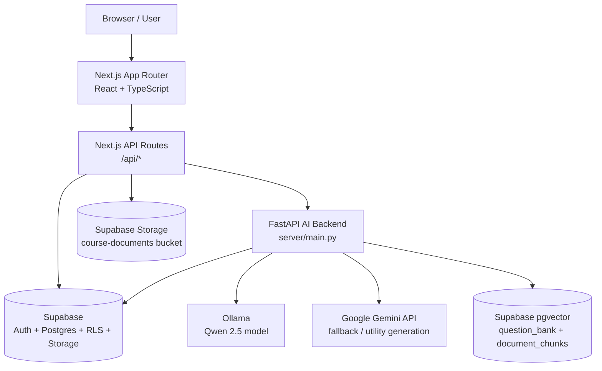
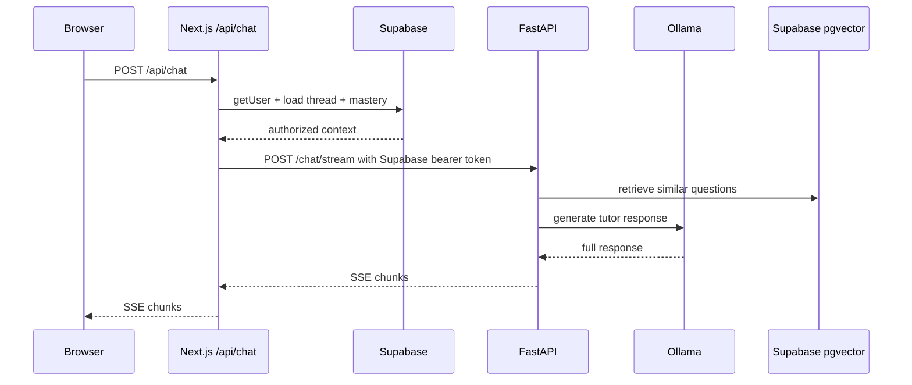
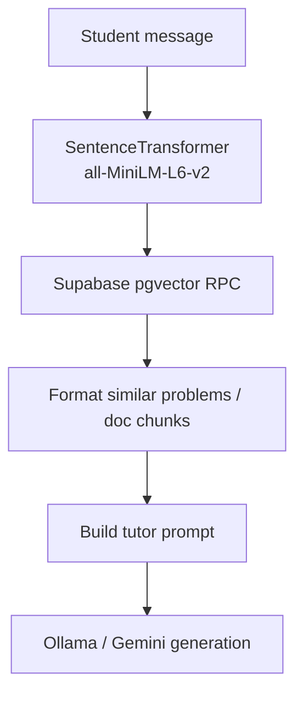
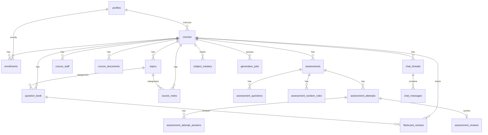
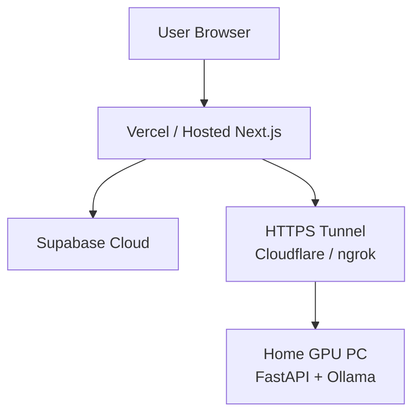

# System Architecture

Last updated: 2026-05-02

This project is an AI board exam reviewer for Philippine engineering and architecture review workflows. It is a full-stack Next.js application backed by Supabase for auth, database, RLS, and storage, plus a separate FastAPI service for AI inference, RAG retrieval, and background AI generation work.

The system has two main runtimes:

- `Next.js`: user interface, authenticated API routes, business logic, Supabase reads/writes, and proxying AI requests.
- `FastAPI`: AI tutor service, Ollama integration, Gemini/Bedrock fallback, Supabase pgvector RAG, AI hints, notes, reviews, and question generation jobs.

## High-Level Diagram



## Runtime Responsibilities

| Runtime | Location | Main responsibility |
|---|---|---|
| Browser client | `app/`, `components/`, `hooks/`, `stores/` | Student/admin UI, chat UI, dashboards, course pages, assessment flows |
| Next.js server | `app/(api)/api/*`, `app/api/chat/route.ts` | Authenticated REST routes, Supabase access, AI proxying, route-level authorization |
| Supabase | External service + `supabase/migrations/` | Auth, PostgreSQL data, RLS policies, storage buckets, RPC helper functions |
| FastAPI | `server/main.py` | AI endpoints, streaming chat, RAG retrieval, background generation jobs |
| Ollama | External local/GPU service | Primary local LLM inference through `qwen2.5:14b-instruct` by default |
| Gemini | External Google API | Fallback provider and utility generation when Ollama is disabled/unavailable |
| RAG store | Supabase pgvector | Question and document chunk embeddings queried via RPC |

## Frontend Architecture

The frontend uses Next.js App Router, React, TypeScript, Tailwind CSS v4, Radix UI, and shadcn-style UI components.

Important directories:

| Path | Purpose |
|---|---|
| `app/(main)` | Student-facing authenticated app: dashboard, course pages, chat, notes, assessments |
| `app/(admin)` | Admin/instructor-facing app: dashboard, course management, question bank, members |
| `app/(api)/api` | Main REST API route handlers |
| `app/api/chat/route.ts` | Chat proxy route used by assistant-ui / chat components |
| `components/assistant-ui` | Assistant UI thread, markdown rendering, thread list, Supabase adapter |
| `components/course`, `components/assessment`, `components/quiz` | Domain UI components |
| `hooks/` | SWR and feature-specific client hooks |
| `stores/` | Zustand stores for courses and assessments |
| `utils/supabase/` | Browser, server, middleware, admin, and typed Supabase helpers |
| `lib/math-preprocessor.ts` | Normalizes AI math delimiters for KaTeX rendering |

The user enters through:

- `/auth`: login/register/reset flows.
- `/dashboard`: student dashboard.
- `/course/[id]`: course workspace.
- `/course/[id]/chat`: AI tutor chat.
- `/admin`: admin dashboard.
- `/admin/course/[id]`: instructor course analytics and management.
- `/admin/course/[id]/assessments`: assessment builder and question bank tooling.
- `/admin/course/[id]/manage`: members, topics, documents, and settings.

## Next.js API Architecture

Next.js API routes are the primary application backend. They authenticate the user with Supabase cookies, check RLS helper functions where needed, perform business logic, and call FastAPI only for AI work.

Current route surface:

| Route | Responsibility |
|---|---|
| `/api/chat` | Authenticated AI chat proxy to FastAPI `/chat/stream` |
| `/api/account/profile` | Read/update current user profile |
| `/api/user/[userId]` | Read basic user information |
| `/api/verify-email` | Trigger email verification |
| `/api/auth/reset-password` | Password reset |
| `/api/threads/[threadId]` | Read/delete chat thread |
| `/api/course/join` | Join course by code/share link |
| `/api/course/[courseId]/analytics` | Student course analytics |
| `/api/course/[courseId]/diagnostic` | Diagnostic quiz load/submit |
| `/api/course/[courseId]/notes` | Course notes CRUD |
| `/api/course/[courseId]/notes/[noteId]` | Single note CRUD |
| `/api/course/[courseId]/topics/[topicId]/practice-questions` | Topic practice questions |
| `/api/course/[courseId]/topics/[topicId]/generate-note` | Generate AI notes through FastAPI |
| `/api/course/[courseId]/summarize-thread` | Turn chat transcript into notes through FastAPI |
| `/api/course/[courseId]/assessment/[assessmentId]/hint` | Generate Socratic assessment hint through FastAPI |
| `/api/course/[courseId]/assessment-review` | Generate/cache wrong-answer AI review |
| `/api/course/[courseId]/flashcard` | Fetch flashcards due for review |
| `/api/course/[courseId]/flashcard/rate` | Update SM-2-style flashcard review state |
| `/api/course/[courseId]/mastery/recalculate` | Recalculate subject mastery |
| `/api/admin/dashboard` | Admin dashboard metrics |
| `/api/admin/course` | Create courses |
| `/api/admin/course/[courseId]` | Read/update/delete course |
| `/api/admin/course/[courseId]/analytics` | Instructor course analytics |
| `/api/admin/course/[courseId]/documents` | Upload/list course documents |
| `/api/admin/course/[courseId]/documents/[documentId]` | Signed URL/delete document |
| `/api/admin/course/[courseId]/members` | Manage members |
| `/api/admin/course/[courseId]/enrollment-requests` | Review enrollment requests |
| `/api/admin/course/[courseId]/topics` | Sync course topics |
| `/api/admin/course/[courseId]/share` | Generate/read join link |
| `/api/admin/course/[courseId]/question-bank` | Manage course question bank |
| `/api/admin/course/[courseId]/question-bank/generate` | Start AI question generation job |
| `/api/admin/course/[courseId]/question-bank/generate/[jobId]` | Poll AI question generation job |

### Chat Proxy Flow

`app/api/chat/route.ts` is intentionally separate from the normal route group because assistant-ui talks to `/api/chat`.

Flow:

1. Browser sends chat messages to `POST /api/chat`.
2. Next.js reads the Supabase session using `utils/supabase/server.ts`.
3. If `courseId` and `threadId` are present, Next.js verifies the thread belongs to the signed-in user.
4. Next.js loads trusted chat history from `chat_threads` and `chat_messages`.
5. Next.js loads subject mastery rows from `subject_mastery` and injects a private personalization note.
6. Next.js calls `${FASTAPI_URL}/chat/stream` with the signed-in user's Supabase access token.
7. FastAPI returns server-sent events, which Next.js streams back to the browser.



## Supabase Architecture

Supabase provides four major services:

- Auth: email/password and OAuth sessions, stored in secure cookies through `@supabase/ssr`.
- PostgreSQL: app data, analytics, question bank, assessments, notes, and chat persistence.
- Row Level Security: table-level policies based on course membership and ownership.
- Storage: uploaded course document files.

### Supabase Clients

| Client | File | Key used | Purpose |
|---|---|---|---|
| Browser client | `utils/supabase/client.ts` | anon/publishable key | Client components and auth UI |
| Server client | `utils/supabase/server.ts` | anon/publishable key + user cookies | API routes and server components that should respect RLS |
| Admin client | `utils/supabase/admin.ts` | service role key | Server-only admin operations that must bypass RLS |
| Middleware/proxy | `proxy.ts`, `utils/supabase/middleware.ts` | anon/publishable key + cookies | Refreshes user session on page requests |

The service role key must never be exposed to client components. It is only imported in server route handlers.

### Core Tables

The current code primarily uses these tables:

| Table | Purpose |
|---|---|
| `profiles` | App profile tied to Supabase `auth.users.id`; stores role and display fields |
| `courses` | Course metadata, join settings, instructor/creator references |
| `topics` | Ordered topics within a course |
| `enrollments` | Student membership and enrollment status |
| `course_staff` | Instructor/TA assignments outside student enrollment |
| `course_documents` | Metadata for uploaded documents in Supabase Storage |
| `chat_threads` | Per-user, per-course chat threads |
| `chat_messages` | Persisted user/assistant/tool messages |
| `assessments` | Assessment configuration |
| `assessment_questions` | Manual assessment question snapshots |
| `assessment_random_rules` | Random question pull rules by subject |
| `assessment_attempts` | Student attempts, scores, timing, status |
| `assessment_attempt_answers` | Per-question answer snapshots for each attempt |
| `question_bank` | Course-scoped question bank used by assessments, practice, flashcards, and RAG sync |
| `course_notes` | User-owned notes inside a course, optionally topic-linked |
| `generation_jobs` | Async AI generation job state/results |
| `subject_mastery` | Per-user subject scores used for analytics and chat personalization |
| `assessment_reviews` | Cached AI explanations for wrong answers |
| `flashcard_reviews` | Per-user spaced repetition state |
| `course_favorites` | User favorites for dashboard/course UX |

Note: older migration scaffolding briefly created `question_bank_questions`, but the active code works against `question_bank`.

### Authorization Model

Course access is centered on Postgres helper functions:

| Function | Meaning |
|---|---|
| `is_admin(user_id)` | True for platform admins |
| `is_course_editor(course_id, user_id)` | True for admins, course instructor, or course staff |
| `is_course_member(course_id, user_id)` | True for active students or course editors |

Common route behavior:

- Student routes require `is_course_member`.
- Instructor/admin routes require `is_course_editor`.
- User-owned resources such as notes, flashcards, and chat threads additionally check `user_id`.
- Some routes use the admin Supabase client after an explicit user-level permission check.

### Storage Model

Course uploads use Supabase Storage.

| Item | Value |
|---|---|
| Bucket | `course-documents` |
| Metadata table | `course_documents` |
| Storage path format | `course-${courseId}/${timestamp}-${sanitizedFileName}` |
| Signed download URL lifetime | 60 seconds |
| Delete behavior | Document row and storage object are both removed |

Document processing status values are:

- `uploaded`
- `processing`
- `ready`
- `failed`

The current architecture stores files and metadata; downstream document-to-RAG processing is represented by metadata/status and can be expanded.

## FastAPI AI Backend

FastAPI lives in `server/main.py`.

Start command:

```bash
npm run dev:server
```

which runs:

```bash
cd server && uvicorn main:app --reload --port 8000
```

The app title is `GEAS Engineering Tutor API`, version `4.0.0`.

### FastAPI Startup

On startup:

1. Reads settings from environment via `config.py` (Supabase URL, service role key, Ollama model, etc.).
2. Initializes a Supabase admin client if configured.
3. Loads the embedding model and `SupabaseVectorRetriever` for pgvector RAG.
4. Builds the AI provider (Ollama primary, Gemini/Bedrock fallback based on config).
5. Configures CORS from `ALLOWED_ORIGINS`, defaulting to `http://localhost:3000`.

### FastAPI Endpoints

| Endpoint | Purpose |
|---|---|
| `GET /` | API metadata |
| `GET /health` | Health status; public even when tutor auth is enabled |
| `POST /chat/ollama` | Dedicated Ollama chat endpoint |
| `POST /chat/qwen` | Legacy alias for Ollama chat |
| `POST /chat` | Legacy chat endpoint |
| `POST /api/chat` | Legacy alias for `/chat` |
| `POST /chat/stream` | SSE-style streaming chat used by Next.js |
| `POST /ai/assessment-review` | Generate concise explanations for wrong answers |
| `POST /ai/generate-notes` | Generate Markdown study notes for a topic |
| `POST /ai/summarize-thread` | Summarize a chat transcript into notes |
| `POST /ai/hint` | Generate a Socratic hint without revealing the answer |
| `POST /generate-questions` | Start background question generation job |
| `GET /generate-questions/{job_id}` | Read question generation job status/results |
| `GET /stats` | Runtime tutor stats |
| `GET /collections` | RAG subject/question counts |
| `POST /benchmark` | Hardcoded tutor benchmark questions |

### FastAPI Security

Most FastAPI routes require the signed-in user's Supabase access token:

```http
Authorization: Bearer <SUPABASE_ACCESS_TOKEN>
```

When `TUTOR_API_KEY` is set, internal service calls may also send it as a fallback:

```http
X-API-Key: <TUTOR_API_KEY>
```

Public paths are:

- `/`
- `/health`
- `/docs`
- `/redoc`
- `/openapi.json`

When FastAPI is exposed through a tunnel or deployed host, `TUTOR_API_KEY` should always be set.

## AI Provider Architecture

AI provider routing is in `server/ai/providers.py`.

Provider order:

1. If `DISABLE_OLLAMA` is not set and Ollama has the configured model, use Ollama.
2. Otherwise, if `GOOGLE_GENERATIVE_AI_API_KEY` is set, use Gemini.
3. Otherwise, raise an error because no provider is available.

### Ollama Provider

Location: `server/ai/ollama.py`

Default model:

```text
qwen2.5:14b-instruct
```

Override with:

```bash
OLLAMA_MODEL=qwen2.5:7b-instruct
```

Responsibilities:

- Primary tutor generation.
- Local model calls through the `ollama` Python package.
- RAG retrieval through Supabase pgvector.
- LaTeX/math formatting post-processing.
- Runtime stats such as average response time and covered topics.

Key generation options include:

- `num_ctx`: 8192
- `num_predict`: 1024 to 1792 depending on path
- `temperature`: low for board-exam precision
- `top_k`, `top_p`, `repeat_penalty`
- GPU-related options such as `num_gpu`, `num_batch`, and `f16_kv`

### Gemini Provider

Location: `server/ai/gemini.py`

Default model:

```text
gemini-1.5-flash
```

Override with:

```bash
GEMINI_MODEL=gemini-1.5-flash
```

Gemini is used when:

- `DISABLE_OLLAMA=true` is set.
- Ollama is not running or the selected model is unavailable.
- Utility generation endpoints call the provider abstraction and the active provider resolves to Gemini.

Required env var:

```bash
GOOGLE_GENERATIVE_AI_API_KEY=
```

## RAG Architecture

RAG is stateless on the FastAPI server — embeddings and vector search live in Supabase pgvector.

Files:

| File | Purpose |
|---|---|
| `server/rag/supabase_retriever.py` | Encodes queries and calls Supabase vector RPCs |
| `server/rag/embedding.py` | SentenceTransformer wrapper for query encoding |
| `server/rag/document_ingester.py` | Chunks and embeds uploaded PDFs into `document_chunks` |
| `server/scripts/backfill_embeddings.py` | One-time backfill for existing `question_bank` rows |

Retrieval flow:



RAG details:

- Embedding model: `all-MiniLM-L6-v2`.
- Vector store: Supabase `question_bank.embedding` and `document_chunks`.
- Top-k: request configurable from 1 to 20, default 5.
- RAG can be disabled per request with `use_rag: false`.
- Similar examples are treated as study context, not authoritative answer keys.

To backfill embeddings after bulk question imports:

```bash
cd server
python -m scripts.backfill_embeddings
```

Document ingestion is triggered via `POST /ai/ingest-document` (queued background task).

## AI Feature Flows

### Tutor Chat

1. Student chats from the course chat UI.
2. Next.js verifies auth and loads trusted thread context.
3. Next.js injects course title and subject mastery context.
4. FastAPI retrieves similar questions from local RAG.
5. Ollama generates a structured tutor response.
6. FastAPI chunks the full response into SSE messages.
7. Browser renders Markdown, math, and code through assistant-ui components.

Current streaming note: `/chat/stream` generates the full model response first, then splits it into word chunks. It is streaming-compatible for the UI, but not true token streaming from the model.

### Assessment Hint

1. Student requests a hint from an assessment question.
2. Next.js checks `is_course_member`.
3. Next.js calls FastAPI `/ai/hint`.
4. FastAPI prompts the active provider to give a 1-2 sentence Socratic hint.
5. System prompt explicitly forbids revealing the correct letter or answer text.

### Wrong Answer Review

1. Student submits/opens review for an assessment attempt.
2. Next.js verifies the attempt belongs to the user and course.
3. If an `assessment_reviews` row exists, it returns cached review data.
4. Otherwise, Next.js fetches wrong answers from `assessment_attempt_answers`.
5. FastAPI `/ai/assessment-review` generates one explanation per wrong answer.
6. Next.js caches the result in `assessment_reviews`.

### AI Notes

There are two note-generation paths:

- Topic notes: `POST /api/course/[courseId]/topics/[topicId]/generate-note` -> FastAPI `/ai/generate-notes` -> insert into `course_notes`.
- Chat summary notes: `POST /api/course/[courseId]/summarize-thread` -> FastAPI `/ai/summarize-thread` -> insert into `course_notes`.

### AI Question Generation

1. Instructor sends topics/count/difficulty to `/api/admin/course/[courseId]/question-bank/generate`.
2. Next.js checks `is_course_editor`.
3. Next.js creates a `generation_jobs` row with status `queued`.
4. Next.js fire-and-forgets a request to FastAPI `/generate-questions`.
5. FastAPI marks the job `running`.
6. FastAPI generates JSON question drafts topic by topic.
7. FastAPI updates the job to `done` with JSON results or `failed` with an error.
8. The frontend polls `/api/admin/course/[courseId]/question-bank/generate/[jobId]`.
9. The instructor reviews/imports generated questions into `question_bank`.

## Data Model Relationships



## State Management

Client-side state is split between SWR and Zustand:

| Layer | Purpose |
|---|---|
| SWR hooks | Fetch and cache server data for courses, members, notes, analytics, documents, favorites |
| `stores/course-store.ts` | Persisted course map and course actions |
| `stores/assessment-store.ts` | Persisted assessment map and assessment actions |
| `components/providers/user-provider.tsx` | Current user/profile context |
| `components/providers/swr-provider.tsx` | App-wide SWR configuration |

Most durable state belongs in Supabase. Zustand is used for UI-friendly caches and local persistence.

## Environment Variables

### Next.js `.env.local`

| Variable | Required | Purpose |
|---|---|---|
| `NEXT_PUBLIC_SUPABASE_URL` | Yes | Supabase project URL |
| `NEXT_PUBLIC_SUPABASE_ANON_KEY` or `NEXT_PUBLIC_SUPABASE_PUBLISHABLE_KEY` | Yes | Browser/server RLS client key |
| `SUPABASE_SERVICE_ROLE_KEY` | For admin APIs | Server-only Supabase admin access |
| `FASTAPI_URL` | For AI | FastAPI base URL, default `http://localhost:8000` |
| `TUTOR_API_KEY` | For secured FastAPI | Shared secret sent to FastAPI |
| `GOOGLE_GENERATIVE_AI_API_KEY` | If using Gemini from Next-side AI SDK paths | Google AI key |

### FastAPI `server/.env`

| Variable | Required | Purpose |
|---|---|---|
| `TUTOR_API_KEY` | Optional fallback | Service-to-service auth when no Supabase user token is forwarded |
| `ALLOWED_ORIGINS` | Production recommended | CORS allowlist |
| `OLLAMA_MODEL` | Optional | Overrides default Ollama model |
| `OLLAMA_HOST` | Optional | Base URL for a custom Ollama server |
| `DISABLE_OLLAMA` | Optional | Forces Gemini provider |
| `GOOGLE_GENERATIVE_AI_API_KEY` | If Gemini fallback needed | Google AI key |
| `GEMINI_MODEL` | Optional | Overrides Gemini model |
| `SUPABASE_URL` or `NEXT_PUBLIC_SUPABASE_URL` | For auth, generation jobs/RAG sync | Supabase project URL |
| `NEXT_PUBLIC_SUPABASE_ANON_KEY` or `NEXT_PUBLIC_SUPABASE_PUBLISHABLE_KEY` | For auth | Verifies Supabase user access tokens |
| `SUPABASE_SERVICE_ROLE_KEY` | For generation jobs/RAG sync | Server-only Supabase admin key |

## Local Development Topology

Run both runtimes:

```bash
npm run dev:all
```

This starts:

- Next.js on `http://localhost:3000`.
- FastAPI on `http://localhost:8000`.

For local Ollama:

```bash
ollama pull qwen2.5:14b-instruct
ollama serve
```

Then run FastAPI:

```bash
npm run dev:server
```

If Ollama is unavailable, set:

```bash
DISABLE_OLLAMA=true
GOOGLE_GENERATIVE_AI_API_KEY=...
```

## Deployment Topologies

### Vercel + Supabase + Home GPU

This is the intended low-cost deployment pattern described by `server/HOME_GPU_PROXY.md`.



Requirements:

- Hosted Next.js has `FASTAPI_URL` set to the tunnel URL.
- Hosted Next.js has `TUTOR_API_KEY` set.
- Home FastAPI has the same `TUTOR_API_KEY`.
- Home PC must stay awake and reachable.
- `GET {FASTAPI_URL}/health` should return healthy status.

### Vercel + Supabase + Gemini Only

Use this when no GPU host is available:

- Set `DISABLE_OLLAMA=true` on the FastAPI host.
- Set `GOOGLE_GENERATIVE_AI_API_KEY`.
- Run FastAPI on any normal server, or adapt deployment to a Python hosting platform.

### Cloud GPU

Use this for production scale:

- Deploy FastAPI and Ollama on a GPU VM.
- Point `FASTAPI_URL` to the GPU VM or load balancer.
- Keep Supabase and Next.js unchanged.
- Set strict `ALLOWED_ORIGINS` and `TUTOR_API_KEY`.

## Security Boundaries

| Boundary | Protection |
|---|---|
| Browser to Next.js | Supabase Auth cookies |
| Next.js routes to Supabase | RLS through server client; service role only after explicit checks |
| Next.js to FastAPI | `TUTOR_API_KEY` bearer token |
| FastAPI public exposure | API key middleware plus CORS allowlist |
| Course data | `is_course_member` and `is_course_editor` checks |
| User-owned records | `user_id` filters and RLS policies |
| Storage files | Private bucket plus short-lived signed URLs |
| AI personalization | Trusted thread/mastery context is loaded server-side, not trusted from the browser |

Important production rules:

- Never expose `SUPABASE_SERVICE_ROLE_KEY` client-side.
- Never expose FastAPI publicly without `TUTOR_API_KEY`.
- Do not commit `.env`, `.env.local`, tunnel URLs, API keys, or service role keys.
- Use HTTPS for any remote `FASTAPI_URL`.
- Restrict `ALLOWED_ORIGINS` in production.

## Build And Verification

Useful commands:

```bash
npm install
npm run dev
npm run dev:server
npm run dev:all
npm run build
npm run lint
```

Database migration:

```bash
supabase db push
```

Embedding backfill:

```bash
cd server
python -m scripts.backfill_embeddings
```

Health check:

```bash
curl http://localhost:8000/health
```

## Known Architectural Notes

- The current FastAPI entry point is `server/main.py` (v4.0, stateless pgvector RAG).
- Chat streaming is SSE-compatible but currently chunked after full generation.
- FastAPI has optional Supabase admin access. Without Supabase env vars, question generation jobs are disabled.
- Question/document embeddings are stored in Supabase; run `scripts/backfill_embeddings` after bulk imports.
- The active question bank table used by code is `question_bank`.
- Supabase is the source of truth for app data and vector embeddings.
