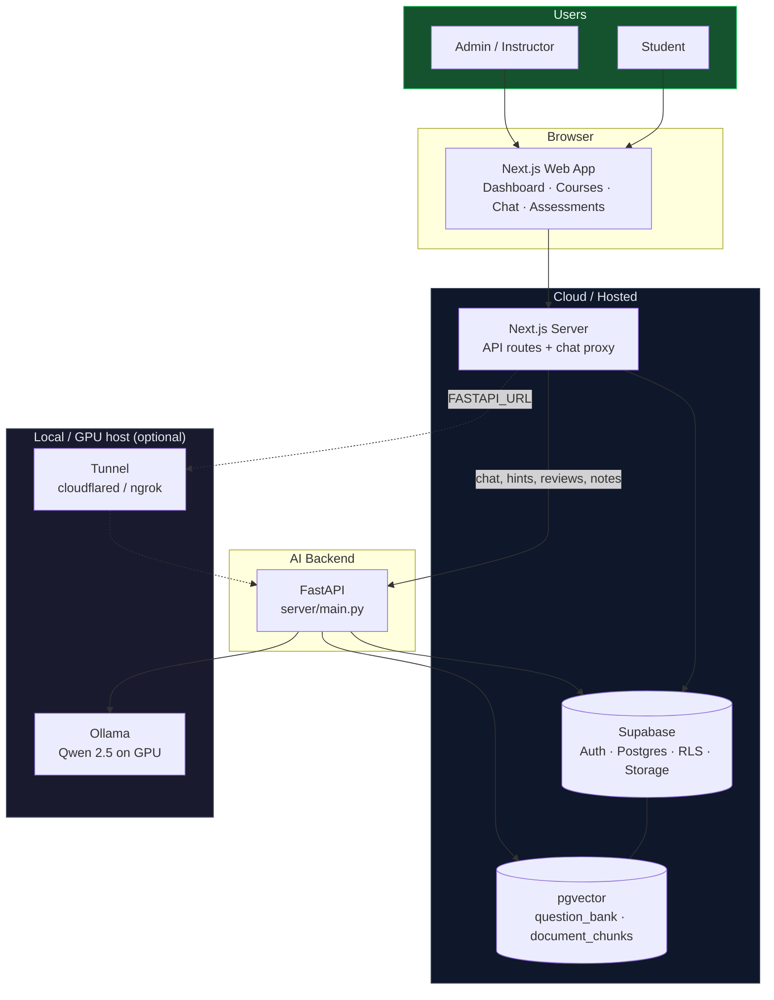
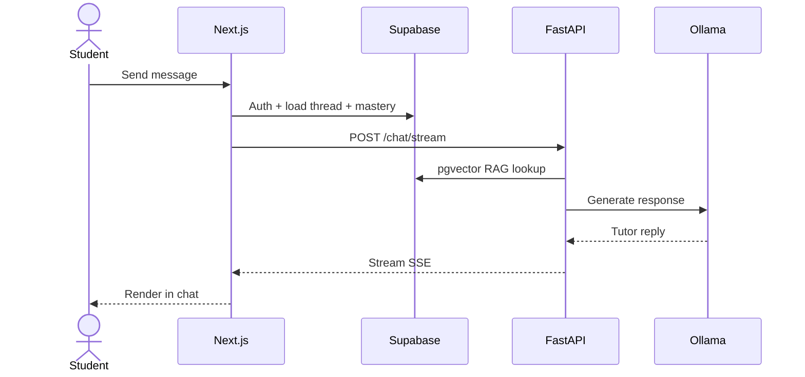
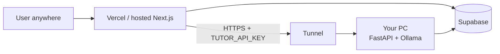

# Architecture Overview

High-level view of the AI Board Exam Reviewer — users, hosted services, and optional local GPU setup.

---

## System map

**Legend**

| Layer | Role |
|-------|------|
| **Users** | Students take courses, chat, assessments; admins manage courses and question banks |
| **Next.js** | UI + authenticated `/api/*` routes; never talks to Ollama directly |
| **Supabase** | System of record — users, courses, attempts, chat threads, files |
| **pgvector** | Embeddings for RAG (exam questions + uploaded PDF chunks) |
| **FastAPI** | All AI work — chat stream, hints, reviews, note generation, embeddings |
| **Ollama** | LLM inference on a local GPU machine |
| **Tunnel** | Exposes home GPU FastAPI to a deployed Vercel app via `FASTAPI_URL` |

---

## Request flows (simplified)

### Typical chat

### Deployed app + home GPU

Students use the hosted site. Chat AI runs on your gaming PC; Supabase stays in the cloud for all data.

---

## Deployment modes

| Mode | Next.js | FastAPI | LLM | Best for |
|------|---------|---------|-----|----------|
| **Local dev** | `localhost:3000` | `localhost:8000` | Ollama | Development |
| **Cloud + home GPU** | Vercel | PC via tunnel | Ollama on GPU | Hosted app, you run the model at home |

See [ADMIN_GUIDE.md](./ADMIN_GUIDE.md) for deployment details and [HOME_GPU_PROXY.md](../server/HOME_GPU_PROXY.md) for the tunnel setup.
